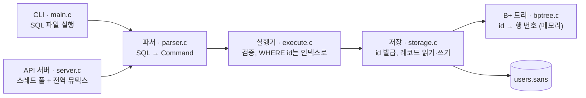

# SANS DBMS

C로 만든 파일 기반 미니 DBMS예요. SQL 파일을 실행하는 CLI에서 시작해서, 100만 행에서 id 조회를 수 µs에 끝내는 B+ 트리 인덱스와 여러 요청을 동시에 받는 HTTP API 서버까지 만들었어요.

팀: 노도현 · 박준호 · 최무헌

## 1. 무엇을 만들었나

| 단계 | 만든 것 | 결과 |
| --- | --- | --- |
| Phase 1 | `INSERT`와 `SELECT … WHERE 열 = 값`을 읽어 바이너리 파일 `users.sans`에 저장하는 SQL 처리기와 CLI | 64바이트 헤더 + 80바이트 고정 길이 레코드, id 자동 발급 |
| Phase 2 | id로 행 번호를 찾는 메모리 B+ 트리 인덱스 (차수 512) | 100만 행에서 id 조회 약 4µs, 전체 순회의 약 1만 배 |
| Phase 3 | `POST /query`로 SQL을 받아 JSON으로 답하는 API 서버와 스레드 풀 | 동시 INSERT 1만 건에서 id 중복·빈틈 0, ThreadSanitizer 경고 0 |



| 담당 | 맡은 것 |
| --- | --- |
| 노도현 | `storage.c`, 인덱스 연결, 성능 측정과 병렬 처리 검증(`bench/`) |
| 박준호 | `parser.c`, `server.c` |
| 최무헌 | `execute.c`, `main.c`, `bptree.c` |

## 2. 시연: CLI로 SQL 파일 실행

시연은 Phase 1 CLI로 해요. 인덱스와 서버는 3·4장의 측정 결과로 보여 줘요.

**준비 (발표 전).** 저장소 루트에서 실행해요. 마지막 줄은 리허설로 생긴 데이터를 지우고 빈 테이블에서 시작하려는 거예요. `build/`는 git이 무시하는 폴더예요.

Linux·Git Bash:

```bash
mkdir -p build/cli
gcc -std=c11 -Wall -Wextra -Werror -pedantic -O2 main.c parser.c execute.c storage.c bptree.c -o build/dbms
rm -f build/cli/users.sans
```

Windows PowerShell:

```powershell
New-Item -ItemType Directory -Force build\cli | Out-Null
gcc -std=c11 -Wall -Wextra -Werror -pedantic -O2 main.c parser.c execute.c storage.c bptree.c -o build/dbms
Remove-Item build\cli\users.sans -Force -ErrorAction Ignore
```

CLI는 현재 폴더의 `users.sans`를 열고, 없으면 새로 만들어요. ①②의 명령은 PowerShell에서도 그대로 돼요.

① [`demo/phase1.sql`](demo/phase1.sql)을 보여 주고 실행해요. INSERT마다 자동 id가 나오고, SELECT는 `id<TAB>name<TAB>age` 줄과 행 수를 출력해요.

```bash
cd build/cli
cat ../../demo/phase1.sql
../dbms ../../demo/phase1.sql
```

```text
INSERT OK id=1
INSERT OK id=2
INSERT OK id=3
1	kim	23
2	lee	31
3	park	23
SELECT OK rows=3
1	kim	23
3	park	23
SELECT OK rows=2
```

② 같은 파일을 한 번 더 실행해요. id가 4부터 이어지고 `SELECT OK rows=6`이 나와요. 프로그램을 껐다 켜도 데이터가 파일에 남아 있다는 뜻이에요.

```bash
../dbms ../../demo/phase1.sql
```

③ 파일이 실제로 바이너리 형식인지 보여 줘요.

Linux·Git Bash:

```bash
xxd users.sans | head -6
```

Windows PowerShell (`xxd`가 없어요. 다른 명령과 한 줄에 묶지 말고 이 줄만 실행해야 표 모양으로 나와요):

```powershell
Format-Hex users.sans | Select-Object -First 6
```

- 첫 줄의 `SANS`(`53 41 4E 53`)가 파일 표시이고, 그 뒤로 버전 1, 헤더 64바이트(`0x40`), 레코드 80바이트(`0x50`)예요.
- 둘째 줄은 행 수 6과 다음 id 7이에요. `0x40`부터 첫 레코드 `id 1, age 23(0x17), kim`이 이어져요. 형식은 [저장 세부 설계 4장](docs/storage.md)에 있어요.

## 3. 결과: 인덱스로 id 조회 약 1만 배

### 조회 시간

| 100만 행, 무작위 id 1,000개 중앙값 | Linux | Windows |
| --- | --- | --- |
| **id 조회 + 인덱스** | **3.98µs** | **7.60µs** |
| name 조회 (전체 순회) | 43.2ms | 68.9ms |
| 열기 (파일 읽기 + 트리 구축) | 69.1ms | 91.8ms |

### 인덱스 모양

| 항목 | 값 | 뜻 |
| --- | --- | --- |
| 높이 | 3 | 노드 3개만 내려가면 찾아요 |
| 메모리 | 30.8MiB | 트리를 메모리에만 두고 파일에 저장하지 않아요. 그래서 열 때마다 다시 만들어요(위 표의 열기) |
| 리프 채움률 | 50.1% | id가 오름차순으로만 들어와서 리프가 반만 차요 |
| 결과 불일치 | 0 | 무작위 id 1,000개와 없는 id 4개를 인덱스와 전체 순회로 찾은 결과가 모두 같아요 |

### 측정 조건

| 항목 | 값 |
| --- | --- |
| 측정 프로그램 | [`bench/index_bench.c`](bench/index_bench.c). 저장 API를 직접 불러 SQL 처리기를 거치지 않아요 |
| 기계 | Intel Core Ultra 7 258V (8코어 8스레드), RAM 31.5GB, NVMe SSD. Linux와 Windows가 같은 기계예요 |
| OS와 컴파일러 | Linux: Ubuntu (Docker Desktop, WSL2), gcc 15.2.0<br/>Windows: Windows 11 Home, MSYS2 MinGW-w64 gcc 16.1.0 |
| 빌드 | `-O2`, 트리 차수 512 |
| 데이터 | 100만 행 (이름 `user<id>`, 나이 `id % 100`) |
| 반복 | 조회는 무작위 id 1,000개(시드 20), 열기는 5번 |
| 참고 | 파일을 만든 직후 같은 프로세스에서 재서, 열기와 순회는 디스크보다 운영체제 페이지 캐시에서 읽는 비용에 가까워요 |

전체 표와 원본 출력은 [인덱스 성능 측정](docs/bench.md)에 있어요.

## 4. 결과: 서버는 DB를 한 번에 하나, 기다림은 동시에

메인 스레드가 연결을 받아 대기열에 넣고, 작업 스레드 N개가 요청을 하나씩 끝까지 처리해요. `execute()` 호출만 전역 뮤텍스 하나로 감싸요.

### 처리량

| 초당 요청 수 (100만 행, 클라이언트 16개) | 스레드 1 | 2 | 4 | 8 |
| --- | --- | --- | --- | --- |
| **느린 업로드** (본문 보내기 전 100ms 대기) | 9.8 | 19.6 | 39.2 | 78.4 |
| name 조회 | 22.6 | 22.0 | 21.8 | 21.8 |

| 작업 | 스레드를 늘리면 | 이유 |
| --- | --- | --- |
| 느린 업로드 | 처리량이 스레드 수에 정확히 비례해요 | 기다리는 시간이 잠금 밖이라, 스레드 수만큼 동시에 기다려요 |
| name 조회 | 약 22에서 그대로예요 | 하나가 잠금 안에서 약 43ms 걸려서 초당 `1 ÷ 0.043 ≈ 23`번이 한계예요. DB 부분은 차례로 돌아요 |

### 정확성

클라이언트 16개가 빈 테이블에 INSERT 10,000건을 동시에 보냈어요(서버 스레드 8).

| 검사 | 결과 |
| --- | --- |
| 서로 다른 클라이언트의 INSERT 구간이 실제로 겹쳤나 | 통과 (클라이언트 16개의 120쌍 모두) |
| INSERT 응답 수 = 보낸 수 | 통과 (10,000 / 10,000) |
| 응답 id 중복 | 없음 (0건) |
| id 빈틈 | 없음 (1..10,000) |
| `SELECT *` 결과와 응답의 id·name·age | 일치 (10,000행) |
| 응답 id를 `WHERE id = k`로 조회 (인덱스) | 일치 (10,000 / 10,000) |
| 강제 종료 뒤 재시작 | 10,000행 그대로, 다음 id 10,001 |

### 데이터 경쟁 (ThreadSanitizer)

| 대상 | `WARNING: ThreadSanitizer` |
| --- | --- |
| 일부러 경쟁을 만든 시험 프로그램 (TSan이 실제로 잡는지 먼저 확인) | 1건 (잡힘) |
| `-fsanitize=thread`로 빌드한 서버: 처리량 4가지, 막힘 확인, 정확성(INSERT 10,000건 + 강제 종료·재시작) | **0건** |

### 측정 조건

| 항목 | 값 |
| --- | --- |
| 부하 스크립트 | [`bench/load_test.py`](bench/load_test.py) |
| 기계 | 3장과 같은 기계 (Intel Core Ultra 7 258V, 8코어). 서버와 클라이언트가 같은 8코어를 나눠 써요 |
| OS와 도구 | Ubuntu (Docker Desktop, WSL2 커널 6.18), gcc 15.2.0, Python 3.14.4 |
| 서버 빌드 | `-O2 -pthread`. TSan은 `-O1 -g -fsanitize=thread` |
| 부하 | 클라이언트 프로세스 16개. 응답을 받자마자 다음 요청을 보내고, 요청마다 새 연결을 맺어요 |
| 데이터와 시간 | 처리량: 100만 행, 작업마다 5초. 정확성: 빈 테이블. TSan: 10만 행, 작업마다 3초(서버 스레드 8) |

id 조회 처리량, 막힘 확인, 세 번 잰 범위는 [병렬 처리 검증](docs/parallel.md)에 있어요.

## 5. 설계 선택과 알려진 한계

**전역 뮤텍스 하나를 고른 이유와 대가**

- INSERT의 "id 발급 → 레코드 쓰기 → 헤더 쓰기 → 인덱스 갱신"이 한 잠금 안에서 끝나서 서로 어긋날 수 없어요. 잠금이 서버에만 있어서 `storage.c`와 CLI는 `pthread` 없이 그대로예요.
- 대가로 SELECT끼리도 차례로 돌아요. name 조회 클라이언트 2개가 도는 동안 id 조회 응답 시간 중앙값이 0.15ms에서 64ms로 늘었어요(서버 스레드 8, 4장과 같은 조건).
- 읽기·쓰기 잠금과 `pread`를 쓰면 조회끼리 동시에 돌 수 있어요. 회의 자료의 시제품 측정(박준호 PC, 저장 API 직접 호출, HTTP 없음)에서 8스레드 name 조회가 초당 99번으로 전역 뮤텍스(12번)의 약 8배였어요. 바꾸려면 잠금을 저장 모듈 안으로 옮기고, Windows에 없는 `pread`를 대신할 방법이 필요해요.

**알려진 한계**

- 서버가 켜져 있는 동안 같은 `users.sans`를 CLI나 다른 서버로 함께 열면 안 돼요. 프로세스 사이 잠금이 없어서 같은 id가 두 번 쓰일 수 있어요.
- 요청 수신 시간 제한이 없어서, 연결만 열고 멈춘 클라이언트가 작업 스레드 하나를 붙잡아요.
- WHERE 없는 SELECT는 전체 행을 한 응답으로 보내요. 100만 행이면 약 41MiB예요.
- id가 오름차순으로만 들어와서 트리의 리프가 반만 차요(채움률 50.1%).
- 종료 처리는 없어요. 쓰기마다 `fflush`하고 레코드 → 헤더 순서로 써서 Ctrl+C로 꺼도 데이터와 다음 id가 남아요. 전원이 꺼지는 경우는 보장하지 않아요.
- 나머지는 [Phase 2·3 계획 8장](docs/phase2-3.md#8-readme-알려진-한계에-적을-것)에 있어요.

## 빌드와 테스트

```bash
gcc -std=c11 -Wall -Wextra -Werror -pedantic main.c parser.c execute.c storage.c bptree.c -o dbms
./dbms input.sql            # Windows: .\dbms.exe input.sql
python tests/run_tests.py   # 전체 테스트
```

- CLI는 현재 디렉터리의 `users.sans`를 열어요.

API 서버는 `127.0.0.1`에서 `POST /query`로 SQL을 받아 JSON으로 돌려줘요. 서버가 켜져 있는 동안 같은 폴더에서 CLI를 함께 실행하면 안 돼요([5장](#5-설계-선택과-알려진-한계)).

```bash
gcc -std=c11 -Wall -Wextra -Werror -pedantic -pthread server.c parser.c execute.c storage.c bptree.c -o dbms_server
# Windows MinGW-w64: 끝에 -static -lws2_32
./dbms_server --port 8080 --threads 4
curl -s -X POST --data-binary "INSERT INTO users VALUES ('kim', 23); SELECT * FROM users;" http://127.0.0.1:8080/query
# PowerShell에서는 curl 대신 curl.exe
```

- 실행 인자(`--port`, `--threads`, `--queue`)와 응답 형식은 [Phase 2·3 계획 4장](docs/phase2-3.md#4-phase-3-api-서버)에 있어요.
- 3·4장 수치를 다시 재는 방법은 [인덱스 성능 측정](docs/bench.md)과 [병렬 처리 검증](docs/parallel.md) 2장에 있어요.
- `make test`는 전체 테스트가 아니라 파서 단위 테스트만 실행해요. 전체 테스트의 범위와 의존성은 [`tests/README.md`](tests/README.md)에 있어요.
- 공통 인터페이스는 [`dbms.h`](dbms.h)와 [`bptree.h`](bptree.h)에 있어요.

## 설계 문서

- [모듈 구성과 호출 계약](docs/architecture.md) — 담당자, 함수 호출 관계, INSERT·SELECT 흐름, 공개 API와 자원 수명
- [파서 세부 설계](docs/parser.md) — 문장 경계, 토큰·문법 규칙, `Command` 구조, 오류 메시지, 테스트 기대값
- [저장 세부 설계](docs/storage.md) — `.sans` 바이트 형식, 자동 ID, 기록 순서와 복구, `Row` 구조, 테스트 기대값
- [실행기 세부 설계](docs/execute.md), [CLI 세부 설계](docs/main.md), [테스트 설계](docs/test.md)
- [Phase 2·3 계획](docs/phase2-3.md) — B+ 트리 인덱스와 API 서버의 회의 결정, 일정, 계약, 완료 기준
- [인덱스 성능 측정](docs/bench.md) — 100만 행에서 id 인덱스 조회와 선형 조회 비교, 인덱스 구축 시간과 메모리
- [병렬 처리 검증](docs/parallel.md) — API 서버의 스레드 수별 처리량, 잠금 때문에 기다리는 시간, 동시 INSERT 정확성, ThreadSanitizer
