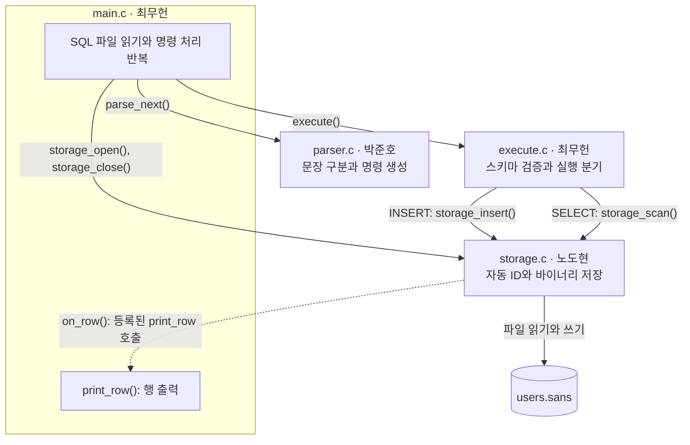
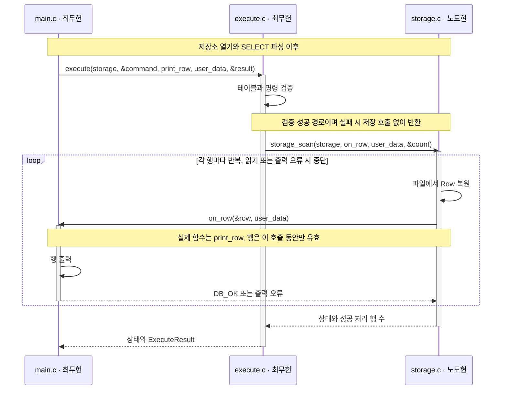

# DBMS 큰 설계: 모듈 구성과 호출 계약

> **검토 목표:** 각 담당자가 누구의 어떤 함수를 호출하는지, 무엇을 넘기고 돌려받는지 합의한다.
> 저장 형식은 **바이너리**, 확장자는 **`.sans`**다. 이 문서는 구현 전 계약 초안이며, 미정 사항은 마지막 절에서 별도로 관리한다.
> **적용 범위:** Phase 1의 CLI·파일 기반 INSERT/SELECT 호출 계약이다. 스키마와 테이블은 사전에 정해져 있으며 CREATE TABLE은 구현하지 않는다.

## 목차

1. [담당과 일정](#1-담당과-일정)
2. [한눈에 보는 호출 관계](#2-한눈에-보는-호출-관계)
3. [명령 하나의 실행 흐름](#3-명령-하나의-실행-흐름)
4. [공통 타입과 공개 함수](#4-공통-타입과-공개-함수)
5. [SELECT 콜백 계약](#5-select-콜백-계약)
6. [오류·소유권·정리 규칙](#6-오류소유권정리-규칙)
7. [세부 설계에서 확정할 사항](#7-세부-설계에서-확정할-사항)
8. [공동 검토 체크리스트](#8-공동-검토-체크리스트)

## 1. 담당과 일정

| 담당자 | 역할 | 구현 파일 | 책임 |
| --- | --- | --- | --- |
| 박준호 | 파서 | `parser.c` | SQL 문장 경계 판단, 호출자가 준비한 명령 채우기와 오류 메시지 작성 |
| 노도현 | 저장 | `storage.c` | 바이너리 파일 입출력, 자동 ID 발급, 행 복원 |
| 최무헌 | 실행기·CLI·테스트 | `execute.c`, `main.c`, 테스트 케이스 | 스키마 검증, 실행 분기, 파일 입력, 출력, 종료 정리와 테스트 |
| 공동 합의 | 모듈 경계 | `dbms.h` | 공통 타입, 공개 함수 선언, 오류와 수명 규칙 |

- **큰 설계:** 3~4시까지 PR로 올리고 함께 검토한다.
- **역할별 세부 설계:** 8시까지 정리한다.
- 위 시각은 팀이 제시한 작업 일정이며, 날짜와 오전·오후는 별도로 확인한다.

파일 내부 보조 함수, 파싱 알고리즘, 바이너리 레이아웃은 각 담당자의 세부 설계 범위다. 단, 공개 계약을 바꾸면 호출하는 담당자와 함께 수정한다.

## 2. 한눈에 보는 호출 관계

**화살표 출발점이 호출자**다. 아래 그림은 WHERE 없는 조회에서 저장 모듈이 전달받은 함수 포인터로 CLI의 출력 함수를 호출하는 경로다. WHERE가 있으면 실행기의 조건 필터를 거쳐 일치하는 행만 CLI에 전달한다(5절).



### 담당자 사이의 실제 호출

| 호출자 | 호출할 함수 | 구현 담당자 | 호출 목적 |
| --- | --- | --- | --- |
| 최무헌 · `main.c` | `parse_next()` | 박준호 | 다음 SQL 명령 생성 |
| 최무헌 · `main.c` | `execute()` | 최무헌 | 명령 검증과 실행 요청 |
| 최무헌 · `main.c` | `storage_open()`, `storage_close()` | 노도현 | 저장소 열기와 종료 |
| 최무헌 · `execute.c` | `storage_insert()` | 노도현 | 검증된 값 저장 |
| 최무헌 · `execute.c` | `storage_scan()` | 노도현 | 행 순회 요청 |
| 노도현 · `storage.c` | 전달받은 `on_row(row, user_data)` | 최무헌 | WHERE 없으면 CLI 출력, 있으면 실행기의 필터를 거쳐 일치 행 출력 |

**파서는 저장 모듈을 호출하지 않는다. 실행기와 저장 모듈은 직접 출력하지 않는다.**

`print_row`는 `main.c` 내부의 `static` 함수다. 저장 모듈은 이 함수명을 직접 참조하지 않고 전달받은 `on_row` 함수 포인터만 호출한다.

## 3. 명령 하나의 실행 흐름

1. **준비 — `main.c`**
   `argc`, `argv`에서 SQL 파일 경로를 받고 파일 전체를 문자열과 바이트 길이로 준비한다. 프로그램이 정한 users 저장 경로를 `storage_open()`으로 연다. SQL의 테이블명을 임의 파일 경로로 사용하지 않는다.
2. **파싱 — `main.c` → `parser.c`**
   `main`이 `Command command`와 `char error[PARSE_ERROR_SIZE]`를 준비하고, `cursor = 0`에서 `parse_next(sql, length, &cursor, &command, error)`를 호출한다. 파서는 명령을 채우고 다음 위치로 커서를 전진시킨다. 문법 오류의 이유는 `error`로 받는다. 공백만 남은 정상 끝은 `DB_END`, 미완성 문장은 문법 오류다.
3. **검증 — `main.c` → `execute.c`**
   `execute(storage, &command, print_row, user_data, &result)`를 호출한다. 실행기는 users 테이블, 값의 개수와 자료형, WHERE 열과 값의 자료형을 검증한다. 검증 실패 시 저장 함수를 호출하지 않는다.
4. **실행 — `execute.c` → `storage.c`**
   - **INSERT:** `storage_insert()`가 자동 ID를 발급하고, 기존 레코드를 유지하면서 새 레코드를 추가한다. 성공 시 ID와 레코드 위치가 실행기를 거쳐 `main`으로 전달된다.
   - **SELECT:** `storage_scan()`이 행을 복원해 전달받은 콜백을 호출한다. WHERE가 없으면 `print_row()`, 있으면 실행기의 필터가 일치하는 행만 `print_row()`에 전달한다.
5. **다음 명령 — `main.c`**
   명령은 호출자의 고정 크기 변수이므로 별도 해제하지 않는다. 성공이면 같은 공간을 다음 파싱에 재사용하고, 오류면 처리를 중단한다.
6. **종료 — `main.c` → `storage.c`**
   정상 입력 끝 또는 오류 중단 후, 열린 저장 상태를 `storage_close()`로 정리하고 그 반환값도 확인한다. 전체 성공은 종료 코드 0, 오류는 0이 아닌 값이다. 정상 결과는 표준 출력, 오류는 표준 오류로 보낸다.

## 4. 공통 타입과 공개 함수

### 4.1 `dbms.h`에서 함께 정의할 타입

| 타입 | 담을 내용 |
| --- | --- |
| `DbStatus` | 성공 `DB_OK`, 정상 입력 끝 `DB_END`, 문법·스키마·메모리·범위·파일·손상·출력·기록 결과 불확실 오류를 구별하는 상태 |
| `CommandType`, `ValueType`, `Value` | 명령 종류와 문자열 또는 정수 값의 표현. 파서 설계 3.1절의 공통 정의를 사용 |
| `Command` | 호출자가 준비하는 고정 크기 명령. 종류, 테이블명, INSERT 값 목록과 개수, WHERE 유무·열·값 |
| `Row` | 조회한 `id`, `name`, `age` |
| `Storage` | 열린 저장 파일과 다음 ID 상태. 내부 필드는 저장 모듈만 사용 |
| `InsertResult` | 저장한 ID와 레코드 위치. 위치의 해석은 저장 모듈 담당 |
| `ExecuteResult` | INSERT 저장 결과 또는 SELECT에서 성공 처리한 행 수 |
| `RowHandler` | 한 행과 호출자 상태를 받고 `DbStatus`를 반환하는 함수 포인터 타입 |

파서 쪽 `Command`와 값 타입은 [파서 세부 설계 3.1절](parser.md#31-dbmsh에-들어갈-파서-쪽-정의)을 공통 헤더의 기준으로 사용한다. 나머지 타입의 필드명, 스키마 정수 범위, 상태 값의 실제 C 정의는 세 명이 함께 맞춘다. 각 `.c`에서 같은 타입을 서로 다르게 정의하지 않는다. `RowHandler`는 타입명이지 구현할 함수가 아니다.

현재 저장 API 기준으로 users의 INSERT 값은 `name`(문자열), `age`(정수) 순서이며 `id`는 저장 모듈이 자동 발급한다. SQL 예시는 [파서 세부 설계의 결과 예](parser.md#결과-예)를 참고한다. **P-1~P-3을 수용했다.** 고정 크기 명령과 오류 버퍼, SELECT의 `WHERE 열 = 값` 조건 하나를 사용한다. 식별자는 31바이트, 문자열 값은 255바이트, INSERT 값은 최대 16개이며 오류 버퍼는 끝의 NUL을 포함해 128바이트다. 스키마의 실제 INSERT 값 개수는 2개로 검증한다.

### 4.2 공개 함수 선언 초안

> 아래는 **인터페이스 초안**이다. 공통 타입의 실제 C 정의가 없으므로 그대로 복사해 컴파일하는 완성 헤더가 아니다.

```c
// dbms.h: 공통 타입 정의가 먼저 필요하다.
// size_t: <stddef.h>, int64_t: <stdint.h>
typedef DbStatus (*RowHandler)(const Row *row, void *user_data);

// parser.c · 박준호: PARSE_ERROR_SIZE는 dbms.h에 128로 정의한다.
DbStatus parse_next(const char *sql, size_t length, size_t *cursor,
                    Command *out, char error[PARSE_ERROR_SIZE]);

// execute.c · 최무헌
DbStatus execute(Storage *storage, const Command *command,
                 RowHandler on_row, void *user_data,
                 ExecuteResult *out_result);

// storage.c · 노도현
DbStatus storage_open(const char *path, Storage **out_storage);
DbStatus storage_insert(Storage *storage, const char *name,
                        int64_t age, InsertResult *out_result);
DbStatus storage_scan(Storage *storage, RowHandler on_row,
                      void *user_data, size_t *out_count);
DbStatus storage_close(Storage *storage);
```

`main.c`에는 다음 내부 함수를 둔다. 공개 헤더에 노출하지 않는다.

```c
static DbStatus print_row(const Row *row, void *user_data);
```

### 4.3 함수별 입출력 계약

**직접 반환값**은 호출이 끝날 때 반환하는 상태다. `out_*`는 결과를 받을 변수의 주소를 호출자가 넘기는 **출력 인자**다. `cursor`는 현재 위치를 넣고 다음 위치를 받는 **입출력 인자**다.

| 함수 | 주요 입력 | 직접 반환값 | 출력·상태 변화 |
| --- | --- | --- | --- |
| `parse_next()` | SQL 문자열, 바이트 길이, 현재 커서, 호출자의 `Command *out`과 오류 버퍼 | 명령 생성 `DB_OK`, 정상 끝 `DB_END`, 문법 오류 `DB_ERR_SYNTAX` | 성공 시 명령을 채우고 커서 전진. 오류와 `DB_END`에서는 `out`의 필드를 0으로 초기화. 문법 오류에는 줄바꿈 없이 NUL로 끝난 영어 한 줄 오류 메시지, 그 외에는 빈 오류 문자열 |
| `execute()` | 열린 저장 상태, 명령, 콜백, `user_data`, `out_result` | `DB_OK` 또는 검증·저장·콜백 오류 | INSERT 성공 시 저장 결과. SELECT는 조건에 맞아 외부 콜백이 성공한 행 수이며 중간 실패 시 일부 행 수 |
| `storage_open()` | 고정 저장 경로, `out_storage` | `DB_OK` 또는 파일·형식·초기화 오류 | 성공 시 열린 상태와 다음 ID 준비. 실패 시 `*out_storage = NULL` |
| `storage_insert()` | 열린 저장 상태, 검증된 `name`·`age`, `out_result` | `DB_OK` 또는 범위·파일·기록 결과 불확실 오류 | 성공 시 기존 행을 보존하며 새 행 추가, ID·레코드 위치 반환과 다음 ID 갱신. 오류 시 결과는 사용하지 않음 |
| `storage_scan()` | 열린 저장 상태, 콜백, `user_data`, `out_count` | 전체 완료 `DB_OK`, 읽기·손상·콜백 오류 | 행마다 콜백 호출. `*out_count`는 0부터 시작해 콜백 성공 횟수만 누적하며 오류 시에도 확인 가능 |
| `storage_close()` | 열린 `Storage *` | `DB_OK` 또는 남은 기록·파일 종료 오류 | 성공·실패 모두 저장 상태 정리. 호출 후 포인터 무효 |
| `print_row()` | 현재 행, 출력 상태 `user_data` | `DB_OK` 또는 출력 오류 | 지정한 대상으로 `id`, `name`, `age` 출력. 행 해제나 포인터 보관 없음 |

`execute()`는 INSERT에서 콜백을 호출하지 않는다. WHERE 없는 SELECT에서는 같은 `on_row`와 `user_data`를 `storage_scan()`으로 전달한다. WHERE가 있으면 실행기가 내부 필터 콜백과 그 상태를 전달하며, 일치하는 행만 원래 `on_row`와 `user_data`로 전달한다. CLI의 `user_data`에는 출력 대상 `FILE *`를 넣을 수 있다.

## 5. SELECT 콜백 계약

조회 결과 전체를 배열로 만들지 않는다. 저장 모듈이 한 행씩 복원하고, 호출자가 제공한 함수로 전달한다. **같은 호출 흐름에서 순서대로 실행하며 별도 스레드나 메시지 큐는 없다.**

아래 시퀀스는 WHERE 없는 조회다.



이 시퀀스 다이어그램에서 **점선 화살표는 함수 반환**이다. 앞의 호출 관계도에서 콜백 경로를 나타낸 점선과 구별한다.

| 모듈 | SELECT에서 할 일 | 하지 않을 일 |
| --- | --- | --- |
| `main.c` | 콜백과 출력 상태 전달, 행 출력, 출력 성공·실패 반환 | 콜백이 받은 행 해제 |
| `execute.c` | 명령·조건 검증, 일치 행만 외부 콜백에 전달, 성공한 일치 행 수 반환 | 직접 출력 |
| `storage.c` | 파일에서 행 복원, 콜백 호출, 성공 행 수 집계 | 직접 출력, CLI 함수명에 직접 의존 |

- 행과 내부 문자열은 **콜백 실행 중에만 유효**하다. 저장 모듈이 메모리를 관리하며, 받는 쪽에서 해제하지 않는다. 나중에 보관하려면 콜백 안에서 복사한다.
- 콜백이 `DB_OK`면 다음 행으로 진행한다. 오류면 즉시 조회를 중단하고 자원을 정리한 뒤 그 오류를 실행기로 전달한다.
- 빈 테이블은 **`DB_OK`와 0행**이다. `DB_END`는 파서의 정상 입력 끝에만 사용한다.
- 오류 후 행 수는 **이미 성공 처리한 일부 행 수**다. 이미 출력된 행이 있어도 전체 SELECT 성공으로 표시하지 않는다.

WHERE 조건은 `id`, `name`, `age` 중 한 열과 같은 자료형의 값에 대한 동등 비교 하나다. Phase 1은 전체 파일을 순회하며 실행기가 조건을 적용한다. 조건에 맞지 않는 행은 외부 콜백 없이 내부 콜백이 `DB_OK`를 반환한다. `storage_scan()`의 `out_count`는 내부 콜백 성공 횟수이므로 건너뛴 행도 포함한다. `ExecuteResult`에는 외부 콜백이 성공한 일치 행 수를 별도로 기록하며 오류 시에도 이 부분 행 수만 전달한다. 필터의 내부 구조는 실행기 세부 설계에서 정한다.

## 6. 오류·소유권·정리 규칙

### 자원을 만든 모듈과 정리 책임

| 자원 | 생성·관리 | 사용·정리 책임 |
| --- | --- | --- |
| SQL 입력 문자열 | `main`이 준비 | 파서는 빌려 읽음. `main`이 관리 |
| `Command`와 내부 값 | `main`이 고정 크기 공간 준비, 파서는 입력과 독립적으로 복사 | 명령 처리 동안 유효. 별도 해제 없이 다음 파싱에 재사용 |
| 파서 오류 버퍼 | `main`이 `PARSE_ERROR_SIZE` 공간 준비 | 파서가 메시지 작성, `main`이 문장 번호와 함께 오류 출력 |
| `Storage` | `storage_open()`이 생성 | `main`이 열린 상태에 `storage_close()` 호출 |
| 콜백의 `Row`와 문자열 | 저장 모듈이 관리 | 콜백은 빌려 사용. 해제하거나 호출 뒤 포인터 사용 금지 |
| `out_*` 결과 변수 공간 | 호출자가 준비 | 상태를 확인한 뒤 유효한 결과만 사용 |

### 반드시 지킬 규칙

1. `parse_next()`는 성공 시 반드시 커서를 전진시킨다. 오류·`DB_END`에서는 호출자의 명령 필드를 0으로 초기화하며, `DB_END`와 성공에서는 오류 문자열도 비운다.
2. 실행기와 저장 모듈은 전달받은 명령·문자열의 소유권을 가져가지 않는다.
3. `storage_open()` 실패 시 저장 상태는 NULL이다. 성공한 상태만 닫는다.
4. `storage_close()`는 성공·실패 모두 파일과 저장 상태를 정리한다. 종료 오류가 나도 다시 사용하거나 두 번 닫지 않는다.
5. 명령은 동적 할당하지 않으며 해제 함수가 없다. 실행기와 저장 모듈은 호출자의 명령을 보관하지 않는다.
6. SELECT 실패 시 부분 행 수를 제외한 오류 결과를 정상 결과처럼 사용하지 않는다. INSERT 결과는 성공일 때만 사용한다.
7. **기록 결과가 불확실한 INSERT는 자동 재시도하지 않는다.** 미기록 실패로 단정하면 중복 삽입될 수 있다.
8. `main`은 명령 처리 오류뿐 아니라 최종 `storage_close()` 오류도 확인해 전체 성공 여부에 반영한다.

## 7. 세부 설계에서 확정할 사항

현재 공개 호출 구조를 기준으로 아래 항목을 합의한다. 아직 확정되지 않은 정책을 구현 완료된 사실로 취급하지 않는다.

| 항목 | 합의할 내용 | 관련 담당 |
| --- | --- | --- |
| 공통 C 타입 | 수용한 파서 타입·한도를 기준으로 나머지 행·결과 타입과 상태 값 정의 | 전원 |
| 입력과 숫자 범위 | SQL 파일 크기 제한, `id`·`age` 범위, 문자열 길이와 검증 경계 | 전원 |
| 문법과 오류 정보 | 파서 설계의 INSERT/SELECT·WHERE와 오류 버퍼를 사용. 남은 스키마 범위와 오류 표시 형식 확정 | 파서·실행기 |
| 저장 파일 정책 | 파일 생성, 기존 파일 형식 검사, 다음 ID 복원, 손상 처리 | 저장·실행기 |
| 바이너리 레이아웃 | 헤더·레코드 형식, 문자열 표현, 정수 인코딩, 레코드 위치 의미 | 저장 |
| 기록 실패 | 기록 결과 불확실 상태 판정과 이후 처리 정책 | 저장·실행기 |
| CLI와 테스트 | 출력 형식, 오류 표시, 확정된 계약의 테스트 케이스 | 실행기·CLI·테스트 |

현재 파서 계약은 **SQL 파일 전체를 메모리에 읽는 방식**이다. 부분 읽기가 필요해지면 입력 계약을 함께 바꾸되, 지금은 이를 위한 별도 프레임워크를 만들지 않는다.

Phase 2에서는 현재 WHERE 조건 표현을 유지하면서 ID 인덱스 조회·다른 필드 선형 조회의 호출 경로와 인덱스 갱신 담당을 합의한다. Phase 3에서는 API·Thread Pool 연결과 공유 저장 상태의 동시성 정책을 합의한다. 각 단계에서 관련 담당자가 공개 계약을 확장하며, B+ 트리 API나 락 구조는 지금 확정하지 않는다.

## 8. 공동 검토 체크리스트

### 큰 설계 완료 기준

- [ ] 각 담당자가 호출 관계 표에서 자신이 호출할 상대 모듈과 함수명을 확인했다.
- [ ] 파서 → 명령, 실행기 → 검증·분기, 저장 → ID·파일 처리의 경계에 동의했다.
- [ ] `main → execute → storage_scan → print_row` 콜백 경로와 반환 흐름을 이해했다.
- [ ] 공개 함수의 인자·반환값, 출력 인자, 자원 정리 책임에 동의했다.
- [ ] 미정 항목을 각 역할의 세부 설계로 가져가기로 했다.

### 구현 시 확인할 최소 시나리오

- [ ] 파서·실행기·저장 함수의 단위 테스트와 SQL 파일 입력부터 저장·조회까지의 기능 테스트를 구분해 작성
- [ ] 여러 SQL 문장, 공백만 남은 끝, 미완성 문장, 고정 명령 재사용과 오류 버퍼 초기화
- [ ] 잘못된 테이블·값 개수·자료형에서 저장 함수를 호출하지 않음
- [ ] INSERT 성공 시 자동 ID·위치 반환, 재시작 후 ID 복원
- [ ] 빈 SELECT 성공, WHERE의 일치·불일치와 잘못된 조건 거부, 출력 실패 시 중단과 성공한 일치 행 수
- [ ] 파일 열기·읽기·손상·기록·종료 오류 전달과 이중 정리 방지
- [ ] 기록 결과 불확실 오류에서 자동 INSERT 재시도 없음

이 체크리스트는 검토·테스트 계획이며, 현재 구현이나 테스트 통과를 의미하지 않는다.
