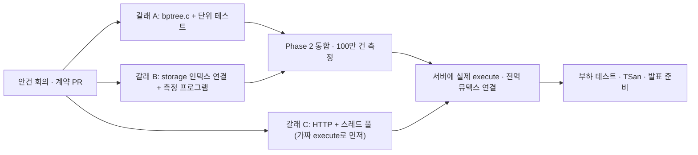
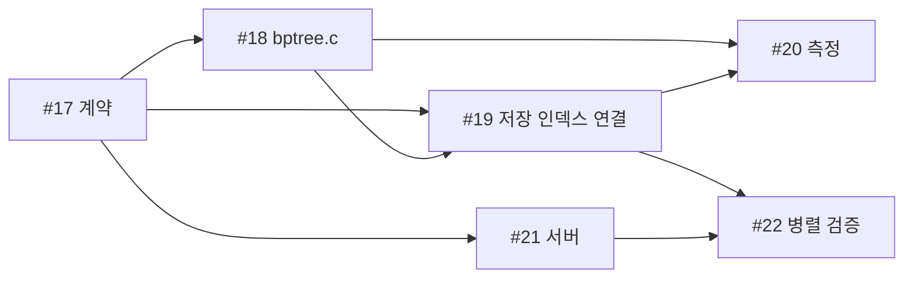
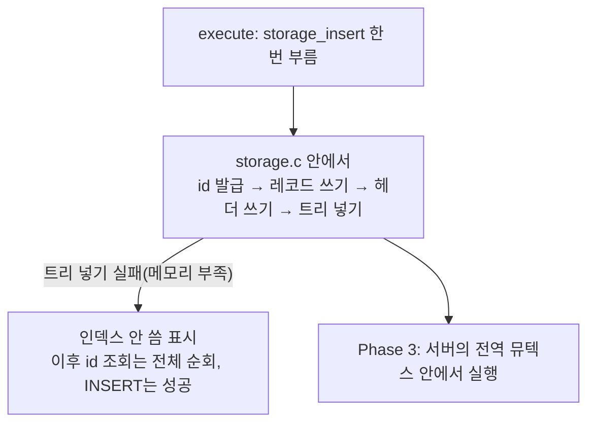
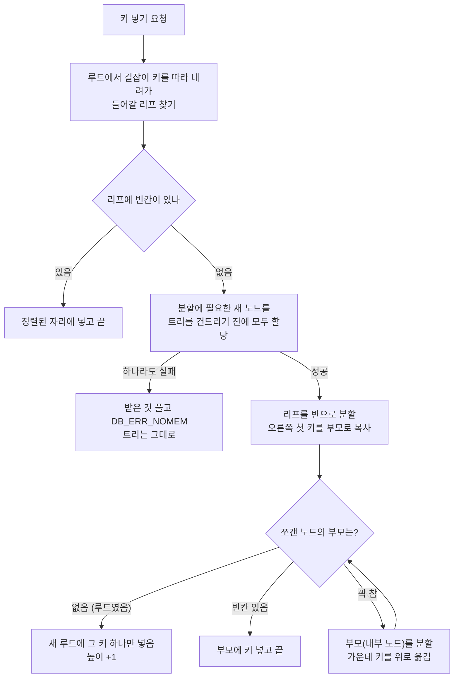
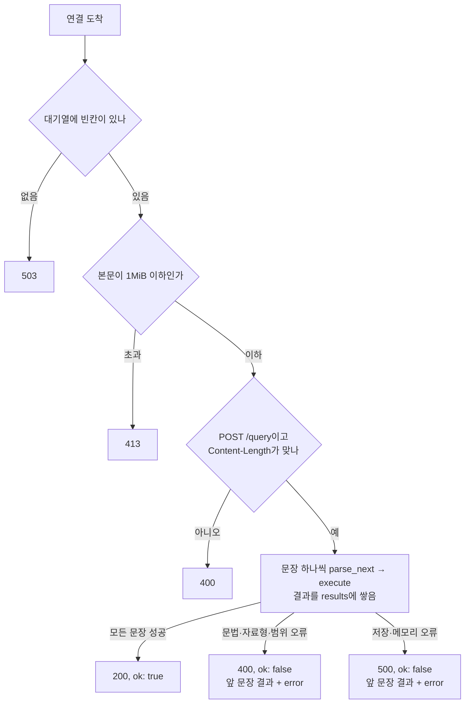
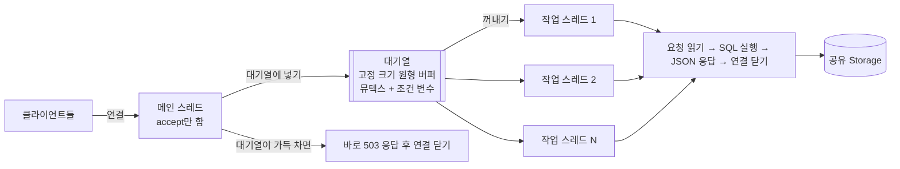

# Phase 2·3 계획 (B+ 트리 인덱스 · API 서버)

> **출처:** Notion "미니 DBMS Phase 2·3 계획과 안건" 페이지(2026-11-18 회의 결정 반영). 기준 코드는 `main` `4f1f862`예요.
> **기준 문서:** [모듈 구성과 호출 계약](architecture.md) 7절, [저장 세부 설계](storage.md) 8.2·8.3절.
> **회의 뒤 결정(2026-11-18, Notion에 없음):** 안건 1은 노도현이 정해요. 안건 9의 전역 뮤텍스는 서버가 `execute()` 호출을 감싸는 위치에 둬요([4.5절](#45-동시-접근-제어-안건-9-a)).
> 이 문서는 회의에서 정한 것과 그에 따른 구현 계획을 적어요. 공개 함수 선언과 서버 구성은 #17에서 확정했어요([6장](#6-계약-17)).
> **표시:** 측정값은 Notion 페이지의 실측(박준호 PC, Ryzen 7 5800X 8코어 16스레드, gcc 15.2.0, 데이터 파일은 tmpfs)이에요. 발표 수치는 시연 PC에서 다시 재요. "추론"이라고 적은 것은 결정에서 따라 나온 것이고 회의에서 따로 정하지 않았어요.

## 목차

1. [결정 요약](#1-결정-요약)
2. [일정과 역할](#2-일정과-역할)
3. [Phase 2: B+ 트리 인덱스](#3-phase-2-b-트리-인덱스)
4. [Phase 3: API 서버](#4-phase-3-api-서버)
5. [참고 측정값](#5-참고-측정값)
6. [계약 (#17)](#6-계약-17)
7. [완료 기준](#7-완료-기준)
8. [README "알려진 한계"에 적을 것](#8-readme-알려진-한계에-적을-것)
9. [정하지 않은 것](#9-정하지-않은-것)

## 1. 결정 요약

| 번호 | 안건 | 결정 |
| --- | --- | --- |
| 1 | 발표 대상(DBMS·Redis 중 하나, 11/19 10:00) | 노도현이 정함 |
| 2 | 서버 지원 플랫폼 | Linux와 Windows MinGW-w64 둘 다 지원 |
| 3 | 인덱스 소유 | A. 저장 모듈이 소유 |
| 4 | 노드 설계와 차수 | 차수 **512**, 나머지는 추천안 그대로 |
| 5 | 성능 측정 방법 | C. 저장 API를 직접 부르는 별도 측정 프로그램 |
| 6 | 통신 방식 | A. 최소 HTTP/1.1 |
| 7 | 요청·응답 형식 | A. 응답은 JSON. 요청 본문은 SQL 원문(안건 6) |
| 8 | 스레드 풀 구조 | 전부 A. 고정 스레드 수, 고정 대기열, 가득 차면 503 |
| 9 | 동시 접근 제어 | A. 전역 뮤텍스 하나. 서버가 `execute()` 호출을 감쌈 |
| 10 | 병렬 처리를 보여 주는 방법 | 노도현이 설계·결정 |
| 11 | 인덱스를 언제 만드나 | A. `storage_open()`에서 재구축 (기본값) |
| 12 | 정확성 검증 방법 | 기본값 |
| 13 | 결과 전송 시점 | 기본값. 메모리 버퍼에 모은 뒤 잠금을 풀고 보냄 |
| 14 | 일정·역할 확정 | **미정** |
| 15 | Notion 설계안과 레포 차이 정리 | **미정** (나중 안건) |

## 2. 일정과 역할

안건 14가 미정이라 아래는 **제안**이에요. 노도현이 안건 1에서 Redis를 발표하기로 정하면 Phase 3를 하루 늦춰도 돼요.

| 시간 (KST) | 할 일 | 끝났다는 기준 |
| --- | --- | --- |
| 11/18 10:30–11:10 | 안건 회의 | 필수 안건 결정 |
| 11:10–12:00 | 계약 PR: `bptree.h`, `dbms.h` 추가 선언, 서버 파일 구성 | 세 명 승인 |
| 13:00–17:00 | 갈래 A·B·C 동시 구현 | 갈래마다 단위 테스트 통과 |
| 17:00–18:00 | Phase 2 통합, 100만 건 측정 | 측정표 기록, 전체 테스트 통과 |
| 19:00–22:00 | 서버에 실제 `execute()`와 전역 뮤텍스 연결, 부하 테스트, TSan | 동시 요청 결과 정확, TSan 경고 0 |
| 22:00–24:00 | 버그 수정, README·docs 갱신 | `main` 병합 |
| 11/19 08:00–09:30 | 발표 자료, 시연 리허설 | 09:30 코드 동결 |



| 갈래 | 맡는 것 | 담당 제안 |
| --- | --- | --- |
| A | `bptree.c`(넣기·찾기·불변식 검사), 대조 테스트 | 최무헌 |
| B | `storage.c` 인덱스 연결(열 때 재구축, INSERT 때 갱신, id 찾기), 실행기 분기, 측정 프로그램, 병렬 처리 검증 | 노도현 |
| C | `server.c`(HTTP), 스레드 풀, 전역 뮤텍스, JSON 응답 | 박준호 |

- Phase 3의 HTTP·스레드 풀은 `execute()`만 알면 되므로 B+ 트리를 기다리지 않아요.
- 실행기 분기(`WHERE id =`를 인덱스로 보내기)는 몇 줄이라 B가 하고 최무헌이 리뷰하는 안이에요.

### 이슈 나누기

#17이 병합되면 #18, #19, #21을 동시에 시작해요. #20·#22는 선행 이슈가 끝난 뒤예요. 화살표는 "먼저 끝나야 하는 것"이에요.

| 이슈 | 내용 | 담당(제안) | 선행 |
| --- | --- | --- | --- |
| #17 | 계약 헤더(`bptree.h`, `dbms.h`)와 서버 구성 합의 | 전원 | 없음 |
| #18 | `bptree.c`와 트리 단위 테스트 | 최무헌 | #17 |
| #19 | 저장 모듈 인덱스 연결, 실행기 분기 | 노도현 | #17. 테스트는 #18 병합 뒤 |
| #20 | 인덱스 성능 측정 프로그램 | 노도현 | #18, #19 |
| #21 | HTTP 서버, 스레드 풀, 전역 뮤텍스 | 박준호 | #17. 가짜 `execute()`로 먼저 개발 |
| #22 | 병렬 처리 검증(부하, 정확성, TSan) | 노도현 | #19, #21 |



여러 이슈가 같이 건드리는 파일은 아래처럼 나눠요. 이 밖의 파일은 이슈 하나만 고쳐요.

| 파일 | 고치는 이슈 | 내용 |
| --- | --- | --- |
| `dbms.h`, `bptree.h` | #17 | 이후 바꾸려면 세 명이 다시 합의 |
| `tests/run_tests.py` | #18, #19, #21 | #18은 트리 테스트 등록, #19는 `storage_regression`·`storage_s01_s02` 빌드 줄에 `bptree.c` 추가(`SOURCES`는 존재 확인용), #21은 서버 빌드 등록. 나중에 병합하는 쪽이 rebase |
| `tests/test_integration.py` `SOURCES`, README·`tests/README.md` 빌드 명령, `tests/storage_test.c` 맨 위 빌드 주석 | #19 | `bptree.c` 추가. `storage_test.c`는 `storage.c`를 `#include`하므로 `bptree.c`를 같이 링크해야 함 |
| `tests/test_execute.c` | #19 | 저장 스텁에 `storage_find_by_id` 추가. 없으면 실행기가 새 함수를 부르는 순간 링크 오류 |
| `execute.c` | #19 | 최무헌이 리뷰 |

## 3. Phase 2: B+ 트리 인덱스

### 3.1 인덱스 소유 (안건 3: A)

- 트리는 `Storage` 안에 둬요. `storage_open()`에서 재구축하고, `storage_insert()`에서 갱신해요.
- ID 발급·행 쓰기·인덱스 갱신이 `storage_insert()` 한 함수 안에 있어 어긋나지 않아요. Phase 3에서는 서버가 `execute()` 호출 전체를 잠그므로 이 함수도 잠금 안에서 돌아요([4.5절](#45-동시-접근-제어-안건-9-a)).
- 트리 자체는 `bptree.c` 독립 모듈이에요. 키·값 숫자만 알고 파일·SQL은 몰라요. 그래야 따로 테스트할 수 있어요.
- [저장 설계 8.2절](storage.md#82-phase-2에서-낼-의견-위치로-한-행-읽기)의 "`row_index`로 한 행 읽기"는 저장 모듈 내부 함수로 써요.
- 새 공개 함수는 "id로 한 행 찾기" 하나예요. 결과 전달은 `storage_scan()`과 같은 콜백 계약이에요([6장](#6-계약-17)).
- **트리 넣기가 메모리 부족으로 실패할 때:** 트리 넣기는 헤더까지 쓴 뒤에 해요. 실패하면 `Storage`에 "인덱스 안 씀" 표시를 남기고, 그 뒤 id 조회는 전체 순회로 찾아요. INSERT는 성공으로 돌려줘요. 행은 이미 저장됐고 결과도 늘 맞아요.



### 3.2 노드 설계와 차수 (안건 4)

- 차수(노드 하나의 최대 자식 수)는 컴파일 때 바꿀 수 있는 상수 `BPTREE_ORDER`이고, **기본값은 512**예요. 테스트는 `-DBPTREE_ORDER=4`로 빌드해서 분할이 자주 일어나게 해요.
- 키는 `int64_t` id, 리프의 값은 `uint64_t` `row_index`예요.
- 리프끼리 다음 리프를 가리키는 연결을 둬요. 지금은 범위 조회가 없지만 B+ 트리의 핵심 성질이라 발표 설명에 필요해요.
- 리프 분할: 오른쪽 노드의 첫 키를 부모로 **복사**해요. 리프에도 남아요.
- 내부 노드 분할: 가운데 키를 부모로 **옮겨요**. 내부 노드에는 남지 않아요.
- 삭제는 만들지 않아요(DELETE가 명세에 없음).
- 같은 키는 구조적으로 들어오지 않아요. 저장 모듈은 읽을 때 `id == row_index + 1`이 아니면 손상으로 거부하고, INSERT는 `next_id`만 써요. 그래서 키는 늘 오름차순이에요. 중복 처리 경로는 만들지 않고 `assert`만 둬요.
- **메모리 부족 처리:** 분할에 필요한 노드(가득 찬 리프 1개 + 위로 이어서 가득 찬 내부 노드 수, 루트까지 가득 차면 새 루트 1개)를 트리를 건드리기 전에 모두 할당해요. 하나라도 실패하면 받은 것을 풀고 `DB_ERR_NOMEM`을 돌려줘요. 실패해도 트리는 그대로예요.



### 3.3 인덱스를 만드는 시점 (안건 11: A)

- `storage_open()`이 파일 전체를 한 번 읽어 트리를 만들어요. 메모리 기반이라 트리는 파일에 저장하지 않아요.
- CLI는 SQL 파일 하나마다 프로그램을 새로 켜므로, 켤 때마다 이 비용이 들어요. 구축 시간은 측정에서 따로 보고해요([3.5절](#35-성능-측정-안건-5-c)).
- **재구축이 끝까지 가지 못할 때(추론):**
  - 메모리 부족: `storage_open()`이 `DB_ERR_NOMEM`을 돌려주고 `*out_storage`는 `NULL`이에요. 지금 `Storage` 할당 실패와 같은 처리예요.
  - 읽기 오류: `DB_ERR_IO`, `NULL`이에요. 지금 열기의 읽기 실패와 같아요.
  - 레코드 손상: 열기는 성공해요. 트리를 버리고 [3.1절](#31-인덱스-소유-안건-3-a)의 "인덱스 안 씀" 표시를 남겨요. 손상은 지금처럼 `storage_scan()`이 그때까지의 `count`와 함께 `DB_ERR_CORRUPT`로 알려요. 열기에서 실패시키면 기존 테스트 T-19·T-28·T-29(`tests/storage_test.c`, 열기 성공 뒤 scan의 `count`가 1·1·2)가 깨져요.

### 3.4 정확성 검증 (안건 12: 기본값)

- 불변식 검사 함수 `bptree_check()`: 노드 안 키 정렬, 모든 리프 같은 깊이, 노드별 키 개수 범위, 리프 연결 순서가 전체 정렬 순서와 같음.
- 대조 테스트: 차수 4로 빌드하고 오름차순으로 10만 개를 넣으며 단순 배열 결과와 비교해요. 불변식은 처음 3,000개까지는 넣을 때마다, 그 뒤로는 997개마다, 다 넣은 뒤에 한 번 검사해요. `bptree_check()`는 트리 전체를 돌므로 10만 개를 넣을 때마다 검사하면 너무 오래 걸려요. 시제품 테스트 전체가 이 간격으로 ASan·UBSan을 켜고 1.1~1.6초였어요.
- 무작위 순서 테스트는 "범용 B+ 트리"라고 설명할 때만 하나 더 둬요. 내림차순은 빼요.
- 경계 사례
  - 1 이상인데 없는 id는 0행이에요.
  - SQL에서 0·음수 id는 지금처럼 `DB_ERR_RANGE`예요(`execute.c`가 `id < 1`을 거절하고 `tests/test_execute.c`가 이것을 기대함). 트리·저장 API 수준에서는 0·음수도 0행이에요.
  - `WHERE id = 'abc'`는 기존 자료형 오류 그대로예요.
- 통합 테스트: 100만 건을 넣고 다시 켠 뒤, 무작위 id 1,000개를 인덱스와 선형으로 각각 찾아 결과가 같은지 확인해요.
- 새 테스트는 `tests/run_tests.py`에 연결해요.

### 3.5 성능 측정 (안건 5: C)

- 저장 API를 직접 부르는 별도 C 측정 프로그램을 둬요. 열기(인덱스 구축)와 조회를 나눠 잴 수 있어요.
- CLI(`main.c`)에는 측정 코드를 넣지 않아요. 지금 CLI 테스트는 인자 2개 이상이면 usage 오류를 검사하므로(`tests/test_cli.py` `test_usage_extra_argument`) 인자 계약도 그대로예요.
- 비교군
  - ① `WHERE id = …` + 인덱스: `storage_find_by_id()`
  - ② `WHERE id = …` 선형: `storage_scan()`으로 id를 비교(추론. Notion 안은 "인덱스 끄기"였음). 같은 열이라 인덱스 효과만 따로 보여요. 시간이 남을 때만 해요.
  - ③ `WHERE name = …` 선형: 명세가 요구하는 비교
- 키는 무작위로 1,000개 뽑아 평균과 중앙값을 내요. 인덱스 구축 시간과 인덱스 메모리 크기도 같이 적어요. 측정 환경(CPU, 디스크, 빌드 옵션)을 표에 적어요.
- 시간 함수는 `clock_gettime(CLOCK_MONOTONIC)`이고 파일 맨 위에 `#define _POSIX_C_SOURCE 200809L`을 둬요. Linux에서 `-std=c11`만 주면 선언이 안 보이고, MinGW-w64에서는 winpthreads에 들어 있어 `-pthread`로 링크해야 해요. C11 `timespec_get`은 MinGW-w64 gcc 13에 선언이 없어 쓰지 않아요.
- 측정 프로그램은 저장 모듈을 직접 불러 SQL 처리기를 거치지 않아요. "Phase 1 처리기와 연동"은 통합 테스트와 시연에서 보여요(추론).
- 발표 그래프: "구축 1회 비용 vs 조회 1회 비용"과 "①②③ 문장당 시간".

## 4. Phase 3: API 서버

### 4.1 지원 플랫폼 (안건 2: 둘 다)

- 서버도 Phase 1처럼 Linux와 Windows MinGW-w64를 둘 다 지원해요. 호환 헤더(선택지 B)와 완전 양쪽 처리(선택지 C) 중 어느 방식인지는 정하지 않았어요.
- 양쪽이 갈리는 것은 소켓이에요. 안건 9가 A(전역 뮤텍스)라 `pread`는 쓰지 않아요(추론).
  - Linux: POSIX 소켓(`<sys/socket.h>`).
  - Windows: Winsock(`<winsock2.h>`). `WSAStartup` 초기화, 닫을 때 `closesocket`, `SOCKET` 자료형, `-lws2_32` 링크가 필요해요.
- 스레드·뮤텍스·조건 변수는 `pthread`로 양쪽에서 같이 써요. `pthread`는 서버만 쓰고 CLI(`main.c`)와 저장 모듈은 쓰지 않아서, CLI와 기존 테스트 빌드 명령은 그대로예요. MinGW에서는 winpthreads로 컴파일되고, `-static`으로 빌드해야 `libwinpthread-1.dll` 없이 실행돼요.
- Linux에서 `-std=c11`만 주면 `pthread_rwlock_t` 같은 일부 선언이 안 보여요. `#define _POSIX_C_SOURCE 200809L`을 둬요.
- ~~스레드 수 기본값을 `sysconf(_SC_NPROCESSORS_ONLN)`으로 구하면 Windows에는 이 함수가 없어 따로 처리해야 해요(추론, 확인 안 됨).~~
  - #17: Windows는 `GetSystemInfo()`를 써요. x86_64-w64-mingw32-gcc 13에서 `-static -lws2_32`로 빌드되는 것을 확인했어요.

### 4.2 통신 방식 (안건 6: A)

- 최소 HTTP/1.1이에요. `POST /query`, 본문에 SQL을 넣어요.
- `Content-Length` 필수, 요청 하나를 처리하고 연결을 닫아요.
- keep-alive 없음, chunked 없음, 본문 최대 1MiB. 그 밖에는 400·413으로 거절해요.
- `curl`로 바로 시연할 수 있어요.

### 4.3 요청·응답 형식 (안건 7: A)

- 요청 본문은 SQL 원문 그대로예요([4.2절](#42-통신-방식-안건-6-a)). JSON으로 감싸지 않아요. 요청의 `Content-Type`은 검사하지 않고, 응답은 `Content-Type: application/json`이에요(추론).
- 응답은 JSON이에요. 문장별 결과 목록이고, 오류면 문장 번호와 메시지를 담아요.
- 문장을 실행하기 전에 거절하는 경우(요청 줄·헤더 오류 400, 브라우저 요청 403, 413, 503)도 같은 모양의 JSON 본문을 보내요(추론). `results`는 빈 배열이고 `error`에 `statement`는 넣지 않아요. `category`는 `request`, `message`는 차례로 `malformed request`, `forbidden`, `body too large`, `server busy`예요. 예: `{"ok":false,"results":[],"error":{"category":"request","message":"server busy"}}`
- 요청 하나에 문장 여러 개를 허용해요. 지금 파서처럼 첫 오류에서 멈춰요. 트랜잭션이 없어서 오류 앞 문장은 이미 저장됐고, 응답의 `results`에 그 결과가 남아요. 실패한 문장의 결과는 `results`에 넣지 않아요. SELECT가 중간에 실패하면(손상·읽기·콜백 오류) 그때까지 버퍼에 모은 행도 버려요.
- JSON 이스케이프는 따옴표·역슬래시·제어 문자만 처리해요. UTF-8이 아닌 바이트는 다루지 않아요.
- `category`와 `message`는 CLI와 같은 문자열을 써요. `main.c`의 `status_category()`·`status_cause()`는 `static`이라 서버에서 부를 수 없으므로, 두 함수를 `server.c`에 복사해요(추론). `main.c`와 `dbms.h`는 고치지 않아요.
  - `category`: `syntax`, `argument`, `schema`, `type`, `range`, `memory`, `io`, `corrupt`, `output`, `write-uncertain`. 파서가 커서를 잘못 돌려준 경우만 `internal`(500)이에요(#21, CLI의 `parse:` 줄과 같은 경우).
  - `message`: 문법 오류는 `parse_next()`가 채운 `error` 문자열(비어 있으면 `status_cause()` 문구), 그 밖에는 `status_cause()` 문구예요. CLI가 표준 오류에 쓰는 것과 같아요.

| 상태 | 경우 |
| --- | --- |
| 200 | 모든 문장 성공, `ok: true` |
| 400 | 요청 줄·헤더 오류, `DB_ERR_SYNTAX`·`ARG`·`SCHEMA`·`TYPE`·`RANGE` |
| 403 | `Origin` 헤더가 있거나 `Host`가 `127.0.0.1`·`localhost`와 포트가 아님([4.4절](#44-스레드-풀-안건-8-전부-a)) |
| 413 | 본문이 1MiB 초과 |
| 500 | `DB_ERR_NOMEM`·`IO`·`CORRUPT`·`OUTPUT`·`WRITE_UNCERTAIN` |
| 503 | 대기열 가득 참 |



- 구현(#21)은 요청 줄과 헤더를 다 읽고 검사한 뒤 본문 크기를 봐요. 그래서 경로가 틀리고 본문도 1MiB를 넘으면 413이 아니라 400이에요.
- 대기열이 가득 차면 별도 스레드 하나가 503을 보내고 남은 요청을 읽고 버린 뒤 닫아요. 읽지 않고 닫으면 클라이언트가 503 대신 연결 리셋을 받기 때문이에요. 이 스레드의 대기열(64개)까지 차면 메인 스레드가 503을 바로 보내고 닫아요. 이때는 요청을 읽지 않아서 클라이언트가 연결 리셋을 볼 수 있어요.

요청 예:

```bash
curl -s -X POST --data-binary "INSERT INTO users VALUES ('kim', 23); SELECT * FROM users WHERE id = 1;" http://localhost:8080/query
```

응답 예(200):

```json
{"ok":true,"results":[{"type":"insert","id":1},{"type":"select","rows":[{"id":1,"name":"kim","age":23}]}]}
```

오류 응답 예(400, 둘째 문장이 문법 오류):

```json
{"ok":false,"results":[{"type":"insert","id":2}],"error":{"statement":2,"category":"syntax","message":"..."}}
```

### 4.4 스레드 풀 (안건 8: 전부 A)

- 메인 스레드는 연결만 받아(`accept`) 대기열에 넣어요. 작업 스레드 N개가 대기열에서 꺼내 요청 하나를 끝까지 처리해요.
- 대기열은 고정 크기 원형 버퍼 + 뮤텍스 + 조건 변수예요.

| 항목 | 결정 |
| --- | --- |
| 스레드 수 | 고정. 실행 인자, 기본값은 CPU 코어 수. 측정에서 1·2·4·8로 바꿔 가며 비교 |
| 대기열 크기 | 고정. 실행 인자, 기본값 128(#17에서 정함) |
| 가득 찼을 때 | 바로 503 응답 후 연결 닫기 |



- 갈래 C는 계약 PR 직후 가짜 `execute()`로 서버부터 만들 수 있어요.
- 서버 구성(#17에서 확정):
  - 파일은 `server.c` 하나예요. HTTP 처리, 스레드 풀, JSON 응답, `main()`이 다 들어가요. 다른 모듈의 공개 함수는 `parse_next()`·`execute()`·`storage_open()`·`storage_close()`만 불러요.
  - 실행 파일은 `dbms_server`이고, 데이터 파일은 CLI와 같은 현재 디렉터리의 `users.sans`예요.
  - `127.0.0.1`에만 열어요. 인증이 없어서 다른 컴퓨터에서 접속하지 못하게 해요.
  - 같은 컴퓨터의 브라우저가 열어 둔 다른 사이트가 `POST /query`를 보내는 것(CSRF)은 루프백만으로 막히지 않아요. 그래서 서버가 직접 거절해요(403, `message`는 `forbidden`).
    - `Origin` 헤더가 있으면 거절해요. 브라우저는 POST에 `Origin`을 붙이고, `curl`·Python 클라이언트는 붙이지 않아요.
    - `Host` 헤더가 있으면 `127.0.0.1:<포트>` 또는 `localhost:<포트>`일 때만 받아요. DNS 리바인딩으로 들어온 요청을 막아요.
    - `Content-Type`은 검사하지 않아요. 본문이 SQL 원문이라 `application/json`을 요구할 수 없고, `text/plain` 같은 단순 요청은 위 두 검사로 막아요.
  - 서버가 켜져 있는 동안 같은 `users.sans`를 CLI나 다른 서버가 함께 여는 것은 지원하지 않아요. 전역 뮤텍스는 서버 프로세스 안에서만 통하고, 각 프로세스가 `storage_open()`에서 다음 id를 따로 읽어서 같은 id가 두 번 쓰이면 파일이 손상으로 판정돼요. 프로세스 사이 잠금은 두지 않아요.
  - 범위 밖이거나 정수가 아닌 값, 모르는 인자, 값 없는 인자는 표준 오류에 usage를 쓰고 종료 코드 1이에요(CLI와 같음). 저장소를 열기 전에 검사해요.
  - 시작 실패(`storage_open()`, `WSAStartup`, `bind`·`listen`, 스레드 만들기)는 표준 오류에 한 줄을 쓰고 종료 코드 1이에요.
  - Linux에서는 CLI처럼 `SIGPIPE`를 무시해요. 클라이언트가 먼저 끊어도 서버가 죽지 않아요.
  - 빌드: Linux `gcc -std=c11 -Wall -Wextra -Werror -pedantic -pthread server.c parser.c execute.c storage.c bptree.c -o dbms_server`, Windows MinGW-w64는 끝에 `-static -lws2_32`를 더해요.
  - 실행: `./dbms_server [--port P] [--threads N] [--queue Q]`

| 인자 | 기본값 | 허용 범위 |
| --- | --- | --- |
| `--port` | 8080 | 1–65535 |
| `--threads` | CPU 코어 수(Linux `sysconf(_SC_NPROCESSORS_ONLN)`, Windows `GetSystemInfo()`). 못 구하면 4, 256보다 많으면 256 | 1–256 |
| `--queue` | 128 | 1–4096 |

### 4.5 동시 접근 제어 (안건 9: A)

- 서버의 전역 뮤텍스 하나로 `execute()` 호출을 감싸요. `parse_next()`는 공유 상태가 없어(바뀌는 `static` 변수 없음) 잠금 밖에서 불러요.
- 잠금을 서버에 두는 이유: 저장 모듈 안에 두면 `storage.c`가 `pthread`를 쓰게 돼 CLI와 모든 테스트 빌드에 `-pthread`(Windows는 `-static`도)를 더해야 해요. 서버에 두면 `storage.c`와 CLI 빌드는 바뀌지 않아요.
- 반드시 지킬 것([저장 설계 8.3절](storage.md#83-phase-3에서-낼-의견-여러-스레드))
  - INSERT의 "ID 발급 → 레코드 쓰기 → 헤더 쓰기 → 인덱스 갱신"은 한 잠금 안에서 함께 해요. `storage_insert()` 한 번이 `execute()` 안에서 불리므로 지켜져요.
  - `FILE *` 하나는 위치가 하나라 위치 이동과 읽기를 같은 잠금 안에서 해요. `storage_open()`·`storage_close()`를 뺀 저장 함수는 모두 `execute()` 안에서만 불리므로 지켜져요.
  - 서버는 `storage_open()`을 작업 스레드를 만들기 전에, `storage_close()`를 작업 스레드가 모두 끝난 뒤에 불러요. 그 밖의 저장 함수는 `execute()` 밖에서 직접 부르지 않아요.
- 그래서 DB 부분은 한 번에 하나씩만 돌아요. 병렬은 네트워크·파싱에만 있어요. SELECT끼리 동시에 읽지 않아요.
- 선택하지 않은 B(읽기·쓰기 잠금 + `pread`)는 측정에서 8스레드 name 조회가 초당 99번으로, A(12번)의 약 8배였어요([5장](#5-참고-측정값)). 시간이 남아 바꾸려면 잠금을 저장 모듈 안으로 옮기고 안건 2(Windows에 `pread` 없음)를 다시 봐야 해요.

### 4.6 결과 전송 시점 (안건 13: 기본값)

- SELECT 콜백은 `execute()` 안에서 불리므로 잠금을 잡은 채로 실행돼요. 콜백에서 소켓으로 바로 보내면 느린 클라이언트 하나가 다른 요청을 모두 막아요.
- 결과는 메모리 버퍼에 모으고, 잠금을 푼 뒤 보내요.
- 응답 크기 상한은 두지 않아요. 100만 행을 JSON으로 쓰면 42,777,786B(약 41MiB)이고, 이만큼을 버퍼에 모은 뒤 보내요.

### 4.7 병렬 처리를 보여 주는 방법 (안건 10: 노도현 결정)

노도현이 설계하고 정해요. 회의 자료의 추천 묶음은 아래와 같고, 결정이 나면 이 절을 고쳐요.

- 부하 스크립트: Python 표준 라이브러리(스레드 + HTTP 클라이언트)로 동시 요청을 보내요.
- 처리량 표: 작업 스레드 1·2·4·8개에서 초당 처리 요청 수. id 조회만, name 조회만, INSERT 섞기.
- 막힘 확인: 느린 name 조회를 돌리는 동안 id 조회 응답 시간.
- 정확성: 동시 INSERT 1만 건 뒤 id 중복 없음, 행 수 일치.
- 데이터 경쟁 검사: ThreadSanitizer(`-fsanitize=thread`)로 부하를 돌려 경고 0.
- Python 스레드는 GIL 때문에 부하를 보내는 쪽이 먼저 막힐 수 있어요. 스레드 수를 바꿔도 처리량이 같으면 클라이언트를 먼저 의심해요.
- 안건 9가 A라, name 조회를 돌리는 동안 id 조회는 그 조회가 끝날 때까지 기다려요(추론).

## 5. 참고 측정값

Notion 페이지의 시제품(`bptree.c`, `storage_bench.c`, `conc_bench.c`, `scale_bench.c`) 측정이에요. 시제품은 박준호 PC의 git 무시 폴더에 있고 레포에는 없어요.

### 5.1 지금 CLI (`main` `4f1f862`, `-O2`)

| 무엇을 | 결과 |
| --- | --- |
| 1,000,000건 INSERT | 5.83초, 파일 80,000,064B |
| 빈 SQL 파일 | 5~9ms |
| `WHERE id = 777777` 1문장 | 77~79ms (지금은 전체 순회) |
| `WHERE name = 'user777776'` 1문장 | 80~84ms |

- 128MiB 입력 상한 때문에 SQL 파일 하나로는 같은 형식에서 2,941,931건까지 넣어요. 그보다 많이 시연하려면 SQL 파일을 나눠 차례로 실행해요.

### 5.2 차수별 (100만 행, 키 오름차순, 3번 중앙값)

| 차수 | 높이 | 노드 메모리 | 트리 만들기 | 열 때 비용(순회 + 트리) | 찾기 | 조회(찾기 + 레코드 1개) |
| --- | --- | --- | --- | --- | --- | --- |
| 64 | 4 | 31.7MiB | 31ms | 86ms | 135ns | 1.45µs |
| 256 | 3 | 30.8MiB | 41ms | 83ms | 127ns | 1.48µs |
| 512 | 3 | 30.7MiB | 41ms | 84ms | 131ns | 1.46µs |

- 500만 행, 차수 512: 높이 3, 153.3MiB, 열 때 비용 432ms, 조회 1.68µs. 같은 크기에서 선형 순회는 205ms예요.
- 32 이상끼리는 찾기·조회 차이가 측정 흔들림 안이에요.
- 오름차순으로만 넣어서 리프가 반만 차요(차수 64에서 50.8%).

### 5.3 비교군 (100만 행, 저장 API 직접 호출, 무작위 id 1,000개)

| 비교군 | 평균 | 중앙값 |
| --- | --- | --- |
| ① id + 인덱스 | 3.4µs | 3.3µs |
| ② id 선형 | 67.7ms | 69.6ms |
| ③ name 선형 | 71.1ms | 71.9ms |
| 인덱스 만들기(열 때 1번) | 140.9ms | 139.6ms |

- 인덱스 결과와 선형 결과가 1,000개 모두 같았어요. 없는 id(0, -1, 1000001, `INT64_MAX`)는 둘 다 0행이에요.
- 5.2절의 열 때 비용(86ms)과 이 표의 인덱스 만들기(약 140ms)는 같은 PC에서 측정 시점만 달라요. 원인은 확인 안 됐어요. 발표 수치는 시연 PC에서 한 번에 다시 재요.
- CLI로 id SELECT를 한두 개만 돌리면 구축 비용 때문에 인덱스 쪽이 오히려 느릴 수 있어요. 그래서 구축과 조회를 따로 재요.

### 5.4 잠금 방식별 초당 처리 수 (저장 API 직접 호출, HTTP 없음)

| 작업 | 방식 | 스레드 1 | 2 | 4 | 8 | 16 |
| --- | --- | --- | --- | --- | --- | --- |
| name 선형 조회 | A. 뮤텍스 (채택) | 16 | 13 | 13 | 12 | 13 |
| name 선형 조회 | B. 읽기·쓰기 잠금 + `pread` | 19 | 40 | 64 | 99 | 118 |
| id 조회 | A. 뮤텍스 (채택) | 569,416 | 339,459 | 365,020 | 396,468 | 402,319 |
| id 조회 | B. 읽기·쓰기 잠금 + `pread` | 687,217 | 1,622,707 | 2,749,255 | 3,712,210 | 3,936,825 |

## 6. 계약 (#17)

#17에서 확정했어요. 바꾸려면 세 명이 다시 합의해요. 선언과 주석은 [`bptree.h`](../bptree.h)와 [`dbms.h`](../dbms.h)의 `storage_find_by_id()`가 기준이고, 아래는 요약이에요. 검사는 `tests/header_contract.c`예요.

```c
/* bptree.h */
#ifndef BPTREE_ORDER
#define BPTREE_ORDER 512  /* 노드 하나의 최대 자식 수. 테스트는 -DBPTREE_ORDER=4 */
#endif
typedef struct BpTree BpTree;
DbStatus bptree_create(BpTree **out_tree);                         /* DB_OK, DB_ERR_NOMEM */
void     bptree_destroy(BpTree *tree);                             /* NULL이면 아무것도 안 함 */
DbStatus bptree_insert(BpTree *tree, int64_t key, uint64_t value); /* DB_ERR_NOMEM이면 트리 그대로 */
int      bptree_find(const BpTree *tree, int64_t key, uint64_t *out_value); /* 찾으면 1, 없으면 0 */
int      bptree_check(const BpTree *tree);                         /* 불변식이 모두 맞으면 1 (테스트용) */

/* dbms.h 추가 */
/* id가 같은 행을 0개 또는 1개 on_row로 넘김. 콜백 계약은 storage_scan()과 같음.
 * 못 찾으면 오류가 아니라 DB_OK, *out_count = 0. */
DbStatus storage_find_by_id(Storage *storage, int64_t id,
                            RowHandler on_row, void *user_data, size_t *out_count);
```

- 실행기: `WHERE id = 정수`이고 지금 검증(1 이상)을 통과하면 `storage_find_by_id()`를 불러요. 나머지는 지금 `storage_scan()` 경로 그대로예요.
- Notion 초안에 있던 측정용 `storage_set_index_enabled()`와 CLI 환경 변수(`DBMS_TIMING`, `DBMS_NO_INDEX`)는 안건 5가 C로 정해져 넣지 않아요. 비교군 ②는 측정 프로그램이 `storage_scan()`으로 재요(추론).
- `storage_open()`은 선언이 그대로예요. 재구축이 끝까지 가지 못할 때의 결과는 [3.3절](#33-인덱스를-만드는-시점-안건-11-a)대로예요.
- 서버 파일 구성(`server.c`, 스레드 풀, HTTP 처리)과 실행 인자는 [4.4절](#44-스레드-풀-안건-8-전부-a)대로예요. 오류 `category`·`message`의 출처는 [4.3절](#43-요청응답-형식-안건-7-a)대로예요.
- [architecture.md 7절](architecture.md#7-세부-설계에서-확정할-사항)의 Phase 2·3 항목도 이 결정으로 채웠어요.

## 7. 완료 기준

### Phase 2

- [ ] 트리 단위 테스트 통과(차수 4, 오름차순 대조, 불변식)
- [ ] 100만 건 넣고 다시 켜서, 무작위 id 1,000개의 인덱스 결과 = 선형 결과
- [ ] 측정표: 인덱스 구축 시간, 비교군 ①③(②는 선택) 문장당 시간, 측정 환경
- [ ] 기존 전체 테스트 통과

### Phase 3

- [ ] `curl`로 INSERT·SELECT 동작
- [ ] Linux와 Windows MinGW-w64에서 서버 빌드·실행 (안건 2에서 따라 나온 것, 추론)
- [ ] 동시 INSERT 뒤 id 중복 없음, 행 수 일치
- [ ] 스레드 수 1·2·4·8 처리량 표
- [ ] ThreadSanitizer 경고 0
- [ ] Ctrl+C로 끄고 다시 켜도 데이터·다음 id 유지(종료 처리 없이)

### 발표

- [ ] 시연 순서: 100만 건 넣기 → id·name 조회 비교 → 서버 켜기 → 동시 요청
- [ ] 그래프 2개(스레드 수별 처리량, 인덱스 효과), 예상 질문 답

예상 질문:

- "id가 1부터 차례로 늘면 계산으로 바로 찾을 수 있지 않나?" 맞아요. 지금 형식에서는 `row_index = id − 1`이에요. 트리가 필요해지는 것은 DELETE로 빈자리가 생길 때, id가 아닌 열에 인덱스를 걸 때, 범위 조회를 할 때예요.
- "같은 값 찾기만 하면 해시 테이블이 더 빠르지 않나?" 같은 값 찾기만 보면 해시가 평균적으로 빨라요. B+ 트리는 정렬 순서와 범위 조회를 지원하는 대가로 log N을 내요.
- "메모리 기반이면 껐다 켜면?" 열 때 다시 만들어요. 그 비용을 측정표로 보여요.
- "SELECT끼리 정말 동시에 도나?" 안건 9가 A라 "아니요, DB 부분은 차례로"라고 답해요. 병렬은 네트워크·파싱 부분이에요.

## 8. README "알려진 한계"에 적을 것

- id가 순서대로 늘어서 반반 분할 후 왼쪽 노드는 반만 찬 채로 남아요. 100만 건에서는 문제없어요.
- `name`에 UTF-8이 아닌 바이트가 있으면 JSON 응답이 올바른 UTF-8이 아닐 수 있어요.
- 서버가 켜져 있는 동안 같은 `users.sans`를 CLI나 다른 서버로 함께 열면 안 돼요. 프로세스 사이 잠금이 없어 같은 id가 두 번 쓰일 수 있어요([4.4절](#44-스레드-풀-안건-8-전부-a)).
- DB 부분은 전역 뮤텍스 하나라 SELECT끼리도 차례로 실행돼요. 100만 행 name 조회(약 70ms) 동안 다른 요청은 기다려요(안건 9에서 따라 나온 것, 추론).
- 요청 수신 시간 제한이 없어 연결만 열고 멈춘 클라이언트가 작업 스레드 하나를 붙잡아요.
- WHERE 없는 SELECT는 전체 행을 한 응답으로 보내요.
- 줄 끝이 `\r\n`이 아니라 `\n`만인 요청은 헤더 끝을 찾지 못해 클라이언트가 끊을 때까지 기다려요(`nc`로 손으로 칠 때 주의).
- 응답 JSON을 만들 메모리가 모자라면 앞 문장이 이미 저장됐어도 응답에는 `results: []`와 `memory` 오류만 남아요.
- 대기열과 503 대기열(64개)이 모두 차면 503을 보내지만 요청을 읽지 않고 닫아서, 요청을 이미 보낸 클라이언트는 503 대신 연결 리셋을 볼 수 있어요.
- 종료 처리 핸들러는 두지 않아요. 쓰기마다 `fflush`하고 헤더를 INSERT마다 갱신하므로 Ctrl+C로 꺼도 데이터와 다음 id는 남아요. INSERT 도중에 프로세스가 죽으면 "레코드 → 헤더" 순서 덕에 파일은 일관돼요. 헤더를 쓰기 전에 죽으면 그 행만 없고, 쓴 뒤에 죽으면 그 행은 남아요. 응답을 받지 못한 클라이언트는 어느 쪽인지 알 수 없어요. 전원이 꺼지는 경우는 보장하지 않아요([저장 설계 5.2절](storage.md#52-storage_insert)).

## 9. 정하지 않은 것

| 항목 | 상태 |
| --- | --- |
| 안건 1. 발표 대상(DBMS·Redis) | 노도현이 정함. Redis면 Phase 3 일정이 하루 늦어질 수 있음 |
| 안건 14. 일정·역할 확정 | 결정 칸이 비어 있음. 2장은 제안 |
| 안건 15. Notion 설계안과 레포 차이 정리 | 나중 안건, 내용 없음 |
| 안건 2의 방식 | 둘 다 지원은 정했지만 호환 헤더(B)인지 완전 양쪽 처리(C)인지는 안 정함 |
| 안건 10의 세부 | 노도현이 정함 |
| ~~Windows 스레드 수 기본값~~ | ~~`sysconf`가 없어 대신할 방법을 정해야 할 수 있음~~ → #17: `GetSystemInfo()`([4.1절](#41-지원-플랫폼-안건-2-둘-다)) |
